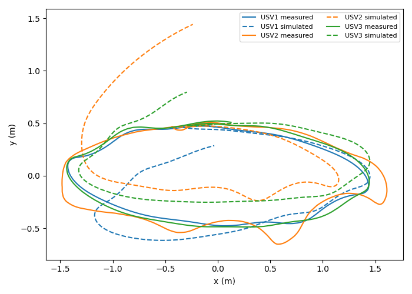
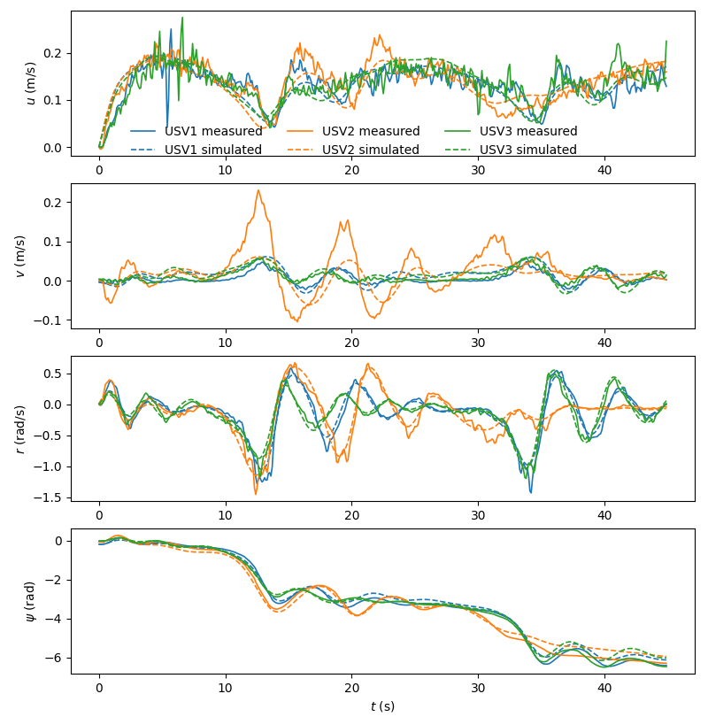
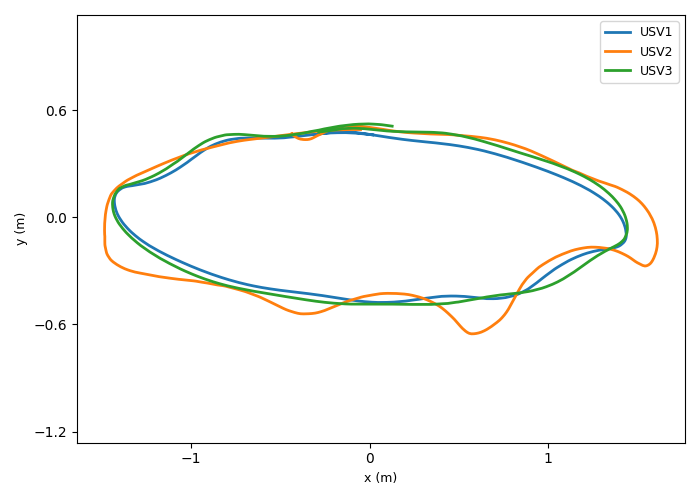
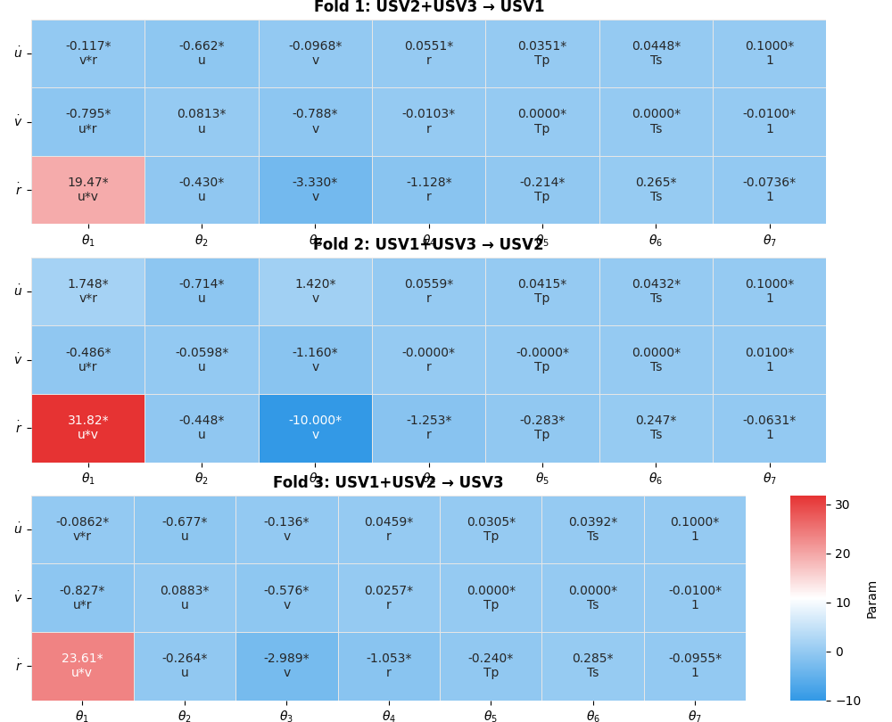
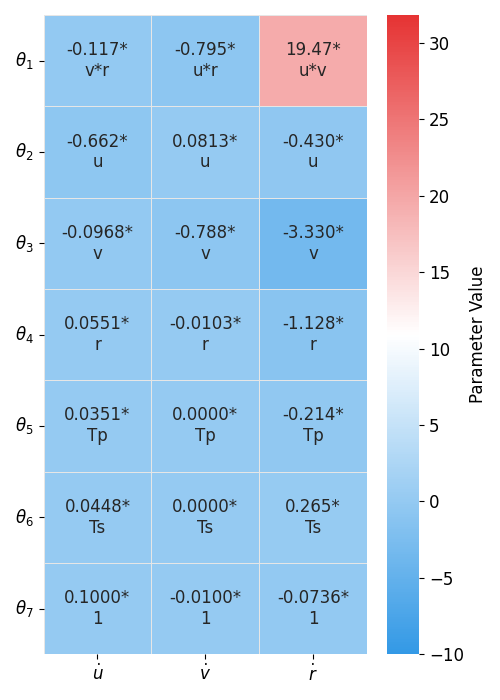
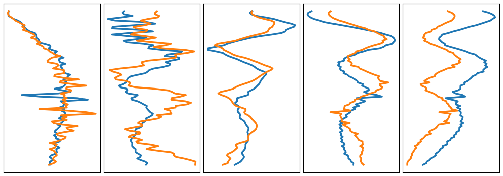
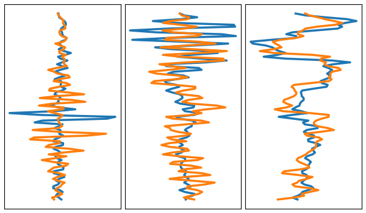

# Formation_Switching_Control_of_USVs

A Practical Data-Driven Framework for Multi-USV Formation Switching Control: Design and Experimental Validation

Demo video (latest): [Formation Switching Control of USVs — Indoor Towing Tank Experiments](https://www.youtube.com/watch?v=DAyNJNGOOjk)

[中文版](README_cn.md)

## Dataset Introduction

This project contains experimental data of three Unmanned Surface Vehicles (USVs), stored in the `data/` directory:

- `usv1_data.xlsx` - USV1 experimental data
- `usv2_data.xlsx` - USV2 experimental data
- `usv3_data.xlsx` - USV3 experimental data

### Data Format

Each Excel file contains the following columns:

| Column  | Description        | Unit |
| ------- | ------------------ | ---- |
| x       | x-axis position    | m    |
| y       | y-axis position    | m    |
| Heading | Heading angle      | deg  |
| u       | Surge velocity     | m/s  |
| v       | Sway velocity      | m/s  |
| PWM_L   | Left thruster PWM  | -    |
| PWM_R   | Right thruster PWM | -    |

### Data Sampling Parameters

- Sampling frequency: 10 Hz (dt = 0.1 s)
- Default data length: 450 rows
- Data source: Real USV experiments

## Multi-USV Model Identification

`multi_usv_identification.py` is used for joint modeling with multi-USV data, using 3-fold cross-validation to evaluate model generalization capability.

### Identification Process

1. **Single USV Preprocessing**

   - Heading conversion: deg → rad, with unwrapping
   - Angular rate calculation: r = d(psi)/dt
   - Smoothing: Savitzky-Golay filter for u, v, r
   - Acceleration calculation: du, dv, dr (finite difference)
   - PWM centering: PWM - 1500
2. **Normalization**

   - Only normalize control inputs Tp, Ts
   - State variables (u, v, r) remain unchanged
3. **Regression Matrix Construction**

   - Block-diagonal feature matrix for each USV (3N × 21)
   - Model form:
     ```
     du = a1*v*r + a2*u + a3*v + a4*r + a5*Tp + a6*Ts + a7
     dv = b1*u*r + b2*u + b3*v + b4*r + b5*Tp + b6*Ts + b7
     dr = c1*u*v + c2*u + c3*v + c4*r + c5*Tp + c6*Ts + c7
     ```
4. **3-Fold Cross-Validation**

   - Fold 1: Train [USV2+USV3] → Test [USV1]
   - Fold 2: Train [USV1+USV3] → Test [USV2]
   - Fold 3: Train [USV1+USV2] → Test [USV3]
5. **Constrained Optimization**

   - SLSQP algorithm
   - Physical meaning based parameter boundary constraints

### Usage

Simply run the script:

```bash
python multi_usv_identification.py
```

### Output Results

1. **Console Output**

   - Data statistics for each USV
   - Cross-validation process and convergence status
   - Detailed MSE results table
   - Identified model parameter equations
2. **Visualization Plots**

   | Figure                        | Description                                                                                                             |
   | ----------------------------- | ----------------------------------------------------------------------------------------------------------------------- |
   |  | **Trajectory Tracking Comparison** - Measured vs simulated trajectories of three USVs                             |
   |  | **State Variables Comparison** - Time series of surge velocity u, sway velocity v, angular rate r, and heading ψ |
   |  | **Measured Trajectories of Three USVs**                                                                           |
   |  | **3-Fold Cross-Validation Parameter Heatmaps** - Identified model parameters for all three folds                  |
   |  | **Fold 1 Parameter Heatmap** - Model parameters trained on USV2+USV3 and tested on USV1                           |
   |  | **Regression Error Analysis (5 folds)**                                                                           |
   |  | **Regression Error Analysis (3 folds)**                                                                           |
3. **Experimental Results Summary**

   - Best model: Trained on USV2+USV3 → Tested on USV1, Overall Score = 0.614
   - All three folds converged successfully, demonstrating good model generalization capability

### Configuration Parameters

Modify the following configurations at the top of the script:

```python
DATA_DIR   = 'data'              # Data directory
BOAT_FILES = ['usv1_data.xlsx', 'usv2_data.xlsx', 'usv3_data.xlsx']
START_ROW  = 0                   # Start row
N_ROWS     = 450                 # Number of rows to use
DT         = 0.1                 # Sampling period
SAVGOL_WIN = 5                   # Smoothing window size
PWM_CENTER = 1500.0              # PWM center value
```

## Dependencies

```bash
pip install numpy pandas matplotlib scipy scikit-learn seaborn openpyxl
```

## Source Code Structure

| Path                            | Description                                                                                                                                                                                                                                                      |
| ------------------------------- | ---------------------------------------------------------------------------------------------------------------------------------------------------------------------------------------------------------------------------------------------------------------- |
| `multi_usv_identification.py` | Core identification script: pooled SLSQP with physical constraints, leave-one-USV-out cross-validation, and ablation study (Individual OLS / Individual SLSQP / Pooled OLS / Pooled SLSQP).                                                                      |
| `data/usv{1,2,3}_data.xlsx`   | Raw experimental data from three twin-propeller USVs (position, heading, velocities, PWM commands).                                                                                                                                                              |
| `esp32c3_boat/`               | Onboard firmware (Seeed Xiao ESP32-C3, PlatformIO/Arduino). Receives UDP thruster commands from the upper computer, supports OTA updates, and implements both single-propeller and twin-propeller modes. See `esp32c3_boat/README.md` for pinout and protocol. |
| `fig/`                        | Identification result figures (trajectory comparison, state variables, parameter heatmaps, regression error analysis).                                                                                                                                           |

> **Note:** The shared-model NMPC controller, the PID/Backstepping baselines, and the Wi-Fi/UDP real-time control loop run on the upper computer and are released together with the experimental data in the paper's supplementary repository.

## Experimental Platform

- **Vessels:** Three 0.2\,m 3D-printed twin-propeller electric USVs.
- **Facility:** Indoor towing tank, 2\,m × 4\,m.
- **Localization:** Optical motion-capture system (VRPN) at 100\,Hz, downsampled to the 10\,Hz control rate.
- **Communication:** Wi-Fi / UDP between the upper computer and each USV.
- **Formation switching:** Triangle → line transition with linear interpolation over $N_{\text{trans}}=50$ steps.

## Citation

If you use this code, please cite:

```
@ARTICLE{Fan2026muti,
  author={Fan, Yunsheng and Liu, Peng and Fugao, Duan and Sun, Xiaojie and Xiaoning, zhang and An, Quan},
  journal={Control Engineering Practice},
  title={A Practical Data-Driven Framework for Multi-USV Formation Switching Control: Design and Experimental Validation},
  year={2026},
}
```

## License

See LICENSE file for details.
